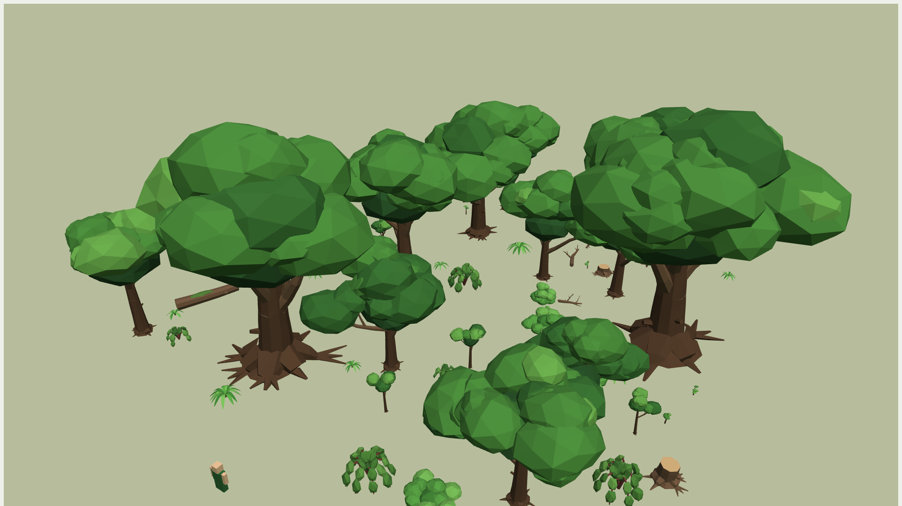
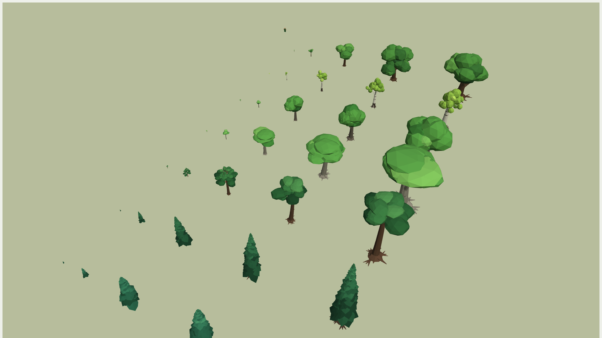
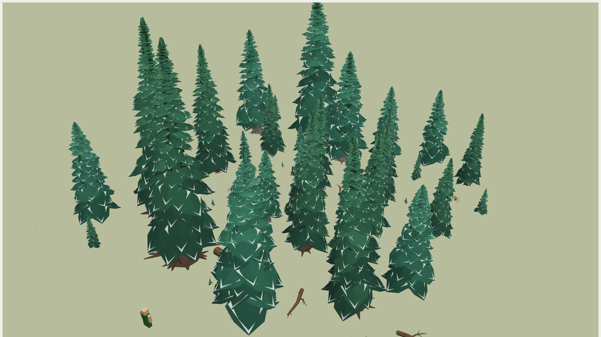

# Forest Kit for Roblox

Low-poly trees, shrubs and deadwood for Roblox Studio: 265 GLB models with flat colours and
no textures, plus the scripts that make them sway in the wind, turn with the seasons and
plant themselves as finished forest chunks.

This repository is the documentation and the script source for the pack. The models are sold
on the Roblox Creator Store. The scripts here are the same files that ship in the download.



## What is in the pack

| | |
|---|---|
| Trees | Oak, Birch, Maple, Beech, Pine, Spruce, Fir. Five growth stages each (Sprout, Sapling, Grown, Elder, Ancient), five variants per stage. 175 models. |
| Shrubs | Bush, BushDense, BushFull, Bramble, Fern. Three sizes (Small, Medium, Large), five variants each. 75 models. |
| Deadwood | Branch, Log, Stump. Five each. 15 models. |
| Scripts | `Setup.lua`, `Verify.lua`, `Organize.lua`, `Wind.client.lua`, `Seasons.server.lua` with `Palettes.lua`, `BuildChunk.lua` with `Chunks.lua`. In [scripts/](scripts/). |
| Chunks | 30 finished forest layouts, 120 by 120 studs, six archetypes (Oak, Birch, Pine, Taiga, Hardwood, Mixed). In [data/chunks/](data/chunks/). |
| Data | [data/manifest.json](data/manifest.json): every model with its parts, materials, triangles and size. [data/seasons.json](data/seasons.json): twelve colour keyframes a year per family. |

Scale: a player is 5 studs. Sprouts are 2 to 3 studs, saplings 8 to 12, grown trees 25 to 32,
elders 36 to 46, ancients 48 to 60.



## Folder layout of the download

```
ForestKit/
  Trees/<Species>/<Species>_Size<N>_<Stage>/<Species>_<Stage>_01..05.glb
  Shrubs/<Family>/<Family>_Size<N>_<Size>/<Family>_<Size>_01..05.glb
  Deadwood/<Family>/<Family>_01..05.glb
  Scripts/        the seven Lua files
  Chunks/         30 forest layouts as JSON (the same data as Scripts/Chunks.lua)
  manifest.json   every model: parts, materials, triangles, height, width
  seasons.json    twelve colour keyframes a year per family
  README.md, AI_GUIDE.md, LICENSE.md
```

Size1 to Size5 are the growth stages in order. The file name is the model id (`Oak_Grown_03`)
that every script and every chunk recipe uses, so keep the names.

## Roblox Studio in five steps

1. **Import.** File > Import 3D, pick the GLB files of a folder, keep the meshes as separate parts
   (do not merge). Each file becomes a Model named after the file.
2. **Set up.** Select the imported Models, paste [scripts/Setup.lua](scripts/Setup.lua) into the
   Command Bar, press Enter. It anchors the parts, puts the pivot at the base, sets the wind pivots,
   writes the attributes and tags, hides the snow caps and makes the trunk collider invisible and
   solid. Then paste [scripts/Verify.lua](scripts/Verify.lua) the same way for a report of anything wrong.
3. **Wind.** Put [scripts/Wind.client.lua](scripts/Wind.client.lua) in StarterPlayer > StarterPlayerScripts
   as a LocalScript.
4. **Seasons, optional.** Put [scripts/Seasons.server.lua](scripts/Seasons.server.lua) in
   ServerScriptService as a Script and [scripts/Palettes.lua](scripts/Palettes.lua) inside it as a
   ModuleScript. It does nothing until you set `Enabled` to true on `ReplicatedStorage.ForestKitSeasons`.
5. **A forest in one run.** Keep the set-up Models in `ServerStorage.ForestKit` with
   [scripts/Chunks.lua](scripts/Chunks.lua) as a ModuleScript inside, edit the settings at the top of
   [scripts/BuildChunk.lua](scripts/BuildChunk.lua), paste it into the Command Bar.

Every step with every switch, and how the pack is published as one Model: [docs/SETUP.md](docs/SETUP.md).

## Turning the wind animation off

Three ways, from permanent to runtime:

- Do not add `Wind.client.lua` to the place. The trees are anchored parts and stand still.
- Open `Wind.client.lua` and set `STRENGTH = 0` at the top. The script rests the parts once and
  then does nothing, so it costs nothing.
- At runtime, from any script or the Command Bar: `workspace:SetAttribute("FK_Wind", false)`.
  `FK_WindStrength` (0 to 2) and `FK_WindRadius` (studs from the camera) tune it the same way.

On phones and tablets the script moves only the trees within 150 studs, 20 times a second, by itself.

## Seasons

Off by default. Attributes on `ReplicatedStorage.ForestKitSeasons`, created on the first run:

| Attribute | Default | Meaning |
|---|---|---|
| `Enabled` | false | nothing happens until this is true |
| `Mode` | Cycle | `Cycle`: one year every `YearLength` seconds. `Realtime`: follows the calendar. `Manual`: your script writes `SeasonTime`. |
| `YearLength` | 3600 | seconds per year in Cycle mode (60 for a one-minute test year) |
| `SeasonTime` | 0.35 | 0 early spring, 0.25 early summer, 0.5 early autumn, 0.75 early winter |
| `UpdateEvery` | 4 | seconds between retints |

Broadleaves and shrubs bud in spring, turn in autumn and stand bare in winter; evergreens shift hue
and carry snow in midwinter; ferns die back. The colours: [docs/PALETTES.md](docs/PALETTES.md).



## Performance

| | Triangles | MeshParts |
|---|---|---|
| One Grown tree, average | 4,200 | 18 |
| One forest chunk, 66 models | about 134,000 | about 1,000 |
| Whole kit, 265 models | 708,000 | 4,090 |

No textures. Roblox's automatic mesh LOD and StreamingEnabled do the rest. The wind script is the
only per-frame cost and it is switchable. Details per species and stage: [docs/PERFORMANCE.md](docs/PERFORMANCE.md).

## For AI assistants

[docs/AI_GUIDE.md](docs/AI_GUIDE.md) is the contract: naming, the parts inside every model and
their roles, the attributes and tags Setup writes, the palettes and keyframes, the chunk recipe
format, and ready Lua snippets for placing, finding, retinting and switching things. [llms.txt](llms.txt)
is the short index.

## Licence

[LICENSE.md](LICENSE.md): use everything in any experience you make, free or paid; do not resell
or redistribute the assets themselves.
