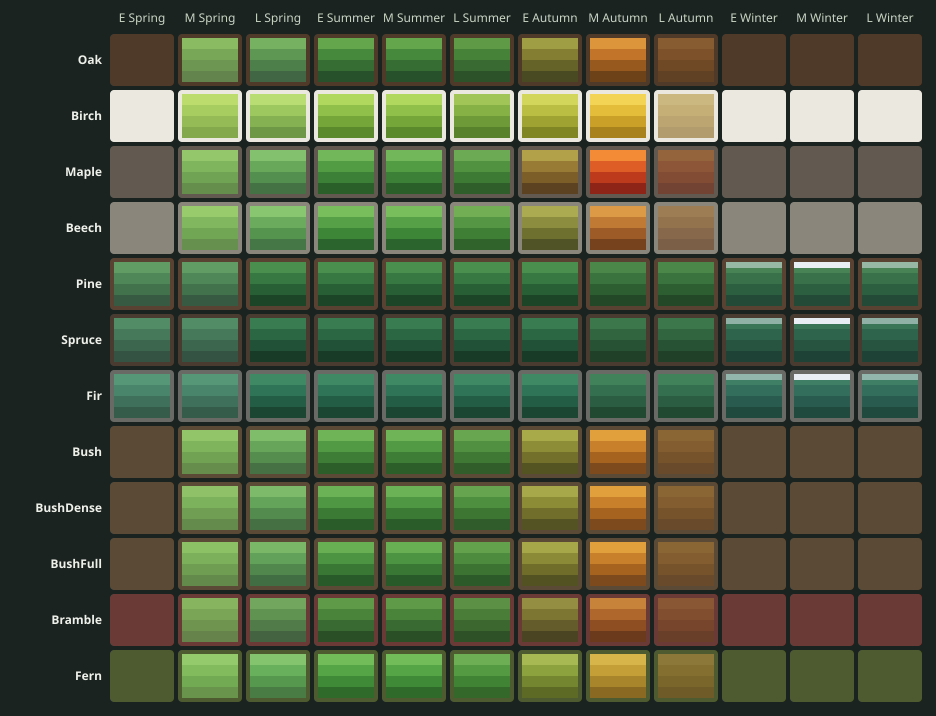

# Colour palettes

Every part of a model is one flat colour, chosen by its role (`FK_Role` after Setup.lua). These
are the colours the models ship with and the twelve keyframes a year the Seasons script fades
between. Hex values, sRGB. `-` means the part is hidden in that palette (leaves in Bare, snow
outside winter). The same numbers are in `data/manifest.json` (`palettes`) and `data/seasons.json`.

Each row is a family, each column a keyframe; the four bands are Leaf1 (darkest, inside the crown)
to Leaf4 (lightest, on top), faded by leaf opacity; the white strip is the snow cap when it shows.

## The four fixed palettes

Summer, Autumn, Snow and Bare, as the viewer's buttons show them.

### Oak

| Role | Summer | Autumn | Snow | Bare |
|---|---|---|---|---|
| Bark | `#4f3a2a` | `#4f3a2a` | `#4f3a2a` | `#4f3a2a` |
| BarkLight | `#66503b` | `#66503b` | `#66503b` | `#66503b` |
| Leaf1 | `#27512a` | `#6e4219` | `#27512a` | - |
| Leaf2 | `#356d32` | `#98591e` | `#356d32` | - |
| Leaf3 | `#47893c` | `#c27429` | `#47893c` | - |
| Leaf4 | `#63a64c` | `#dd953c` | `#63a64c` | - |
| Snow | - | - | `#e9eef4` | - |

### Birch

| Role | Summer | Autumn | Snow | Bare |
|---|---|---|---|---|
| Bark | `#ebe8df` | `#ebe8df` | `#ebe8df` | `#ebe8df` |
| BarkLight | `#f4f2ea` | `#f4f2ea` | `#f4f2ea` | `#f4f2ea` |
| BarkDark | `#2b2824` | `#2b2824` | `#2b2824` | `#2b2824` |
| Leaf1 | `#5a8a2c` | `#a8821c` | `#5a8a2c` | - |
| Leaf2 | `#74a63a` | `#caa028` | `#74a63a` | - |
| Leaf3 | `#90c04a` | `#e4bd3a` | `#90c04a` | - |
| Leaf4 | `#b0d85f` | `#f3d455` | `#b0d85f` | - |
| Snow | - | - | `#e9eef4` | - |

### Maple

| Role | Summer | Autumn | Snow | Bare |
|---|---|---|---|---|
| Bark | `#625a50` | `#625a50` | `#625a50` | `#625a50` |
| BarkLight | `#7a7265` | `#7a7265` | `#7a7265` | `#7a7265` |
| Leaf1 | `#2a5f2a` | `#8e2418` | `#2a5f2a` | - |
| Leaf2 | `#3b8036` | `#bd3b1c` | `#3b8036` | - |
| Leaf3 | `#529c44` | `#de5c26` | `#529c44` | - |
| Leaf4 | `#72b85a` | `#f28a36` | `#72b85a` | - |
| Snow | - | - | `#e9eef4` | - |

### Beech

| Role | Summer | Autumn | Snow | Bare |
|---|---|---|---|---|
| Bark | `#8a867c` | `#8a867c` | `#8a867c` | `#8a867c` |
| BarkLight | `#9d998f` | `#9d998f` | `#9d998f` | `#9d998f` |
| Leaf1 | `#2b642c` | `#76421e` | `#2b642c` | - |
| Leaf2 | `#3d8537` | `#9d5c27` | `#3d8537` | - |
| Leaf3 | `#56a048` | `#c17a33` | `#56a048` | - |
| Leaf4 | `#79be5c` | `#dc9a47` | `#79be5c` | - |
| Snow | - | - | `#e9eef4` | - |

### Pine

| Role | Summer | Autumn | Snow | Bare |
|---|---|---|---|---|
| Bark | `#5a4232` | `#5a4232` | `#5a4232` | `#5a4232` |
| BarkLight | `#7a5640` | `#7a5640` | `#7a5640` | `#7a5640` |
| Leaf1 | `#1c4528` | `#1c4528` | `#1c4528` | `#1c4528` |
| Leaf2 | `#285f34` | `#285f34` | `#285f34` | `#285f34` |
| Leaf3 | `#377741` | `#377741` | `#377741` | `#377741` |
| Leaf4 | `#4b8f4f` | `#4b8f4f` | `#4b8f4f` | `#4b8f4f` |
| Snow | - | - | `#e9eef4` | - |

### Spruce

| Role | Summer | Autumn | Snow | Bare |
|---|---|---|---|---|
| Bark | `#4a3b30` | `#4a3b30` | `#4a3b30` | `#4a3b30` |
| BarkLight | `#5b493c` | `#5b493c` | `#5b493c` | `#5b493c` |
| Leaf1 | `#183b28` | `#183b28` | `#183b28` | `#183b28` |
| Leaf2 | `#215136` | `#215136` | `#215136` | `#215136` |
| Leaf3 | `#2c6744` | `#2c6744` | `#2c6744` | `#2c6744` |
| Leaf4 | `#397c51` | `#397c51` | `#397c51` | `#397c51` |
| Snow | - | - | `#e9eef4` | - |

### Fir

| Role | Summer | Autumn | Snow | Bare |
|---|---|---|---|---|
| Bark | `#696a66` | `#696a66` | `#696a66` | `#696a66` |
| BarkLight | `#7c7d78` | `#7c7d78` | `#7c7d78` | `#7c7d78` |
| Leaf1 | `#1a4632` | `#1a4632` | `#1a4632` | `#1a4632` |
| Leaf2 | `#245d46` | `#245d46` | `#245d46` | `#245d46` |
| Leaf3 | `#307457` | `#307457` | `#307457` | `#307457` |
| Leaf4 | `#3f8964` | `#3f8964` | `#3f8964` | `#3f8964` |
| Snow | - | - | `#e9eef4` | - |

### Bush

| Role | Summer | Autumn | Snow | Bare |
|---|---|---|---|---|
| Bark | `#5a4a36` | `#5a4a36` | `#5a4a36` | `#5a4a36` |
| Leaf1 | `#2c5e2a` | `#7c4a1c` | `#2c5e2a` | - |
| Leaf2 | `#3d7d36` | `#a6631f` | `#3d7d36` | - |
| Leaf3 | `#529a44` | `#c9802a` | `#529a44` | - |
| Leaf4 | `#6fb457` | `#e2a03d` | `#6fb457` | - |
| Snow | - | - | `#e9eef4` | - |

### BushDense

| Role | Summer | Autumn | Snow | Bare |
|---|---|---|---|---|
| Bark | `#5a4a36` | `#5a4a36` | `#5a4a36` | `#5a4a36` |
| Leaf1 | `#2a5c2a` | `#7c4a1c` | `#2a5c2a` | - |
| Leaf2 | `#3b7a35` | `#a6631f` | `#3b7a35` | - |
| Leaf3 | `#4f9743` | `#c9802a` | `#4f9743` | - |
| Leaf4 | `#6bb155` | `#e2a03d` | `#6bb155` | - |
| Snow | - | - | `#e9eef4` | - |

### BushFull

| Role | Summer | Autumn | Snow | Bare |
|---|---|---|---|---|
| Bark | `#5a4a36` | `#5a4a36` | `#5a4a36` | `#5a4a36` |
| Leaf1 | `#285a29` | `#7c4a1c` | `#285a29` | - |
| Leaf2 | `#397734` | `#a6631f` | `#397734` | - |
| Leaf3 | `#4d9442` | `#c9802a` | `#4d9442` | - |
| Leaf4 | `#68ae53` | `#e2a03d` | `#68ae53` | - |
| Snow | - | - | `#e9eef4` | - |

### Bramble

| Role | Summer | Autumn | Snow | Bare |
|---|---|---|---|---|
| Bark | `#6a3b36` | `#6a3b36` | `#6a3b36` | `#6a3b36` |
| Leaf1 | `#2a4f27` | `#6b3a1c` | `#2a4f27` | - |
| Leaf2 | `#396a31` | `#8f4e22` | `#396a31` | - |
| Leaf3 | `#4a843a` | `#b0672c` | `#4a843a` | - |
| Leaf4 | `#5f9a48` | `#c8833a` | `#5f9a48` | - |
| Snow | - | - | `#e9eef4` | - |

### Fern

| Role | Summer | Autumn | Snow | Bare |
|---|---|---|---|---|
| Bark | `#4e5a30` | `#4e5a30` | `#4e5a30` | `#4e5a30` |
| Leaf1 | `#2f6a2a` | `#8a6a22` | `#2f6a2a` | - |
| Leaf2 | `#3f8a36` | `#a8842a` | `#3f8a36` | - |
| Leaf3 | `#55a546` | `#c49e36` | `#55a546` | - |
| Leaf4 | `#73bc5a` | `#d8b54a` | `#73bc5a` | - |
| Snow | - | - | `#e9eef4` | - |

### Deadwood

| Role | Colour |
|---|---|
| Wood | `#6b5340` |
| Grain | `#c9a97c` |
| Moss | `#4f7a3a` |

Snow caps are `#e9eef4` everywhere.

## Twelve keyframes a year

Time of year `t` runs 0 to 1 from early spring; keyframe `floor(t * 12)` blends into the next.
`leaf` and `snow` are opacities (1 = fully shown, 0 = hidden). Bark colours do not change through the year.

### Oak

| Keyframe | Leaf1 | Leaf2 | Leaf3 | Leaf4 | leaf | snow |
|---|---|---|---|---|---|---|
| EarlySpring | `#63844c` | `#6c9651` | `#78a857` | `#8abb62` | 0 | 0 |
| MidSpring | `#63844c` | `#6c9651` | `#78a857` | `#8abb62` | 1 | 0 |
| LateSpring | `#416644` | `#4d7f4b` | `#5d9753` | `#76b161` | 1 | 0 |
| EarlySummer | `#27512a` | `#356d32` | `#47893c` | `#63a64c` | 1 | 0 |
| MidSummer | `#27512a` | `#356d32` | `#47893c` | `#63a64c` | 1 | 0 |
| LateSummer | `#2c522a` | `#386a31` | `#478239` | `#5f9b47` | 1 | 0 |
| EarlyAutumn | `#4a4a22` | `#666328` | `#847e33` | `#a09e44` | 1 | 0 |
| MidAutumn | `#6e4219` | `#98591e` | `#c27429` | `#dd953c` | 1 | 0 |
| LateAutumn | `#6d4621` | `#845223` | `#9b6129` | `#aa7334` | 0.6 | 0 |
| EarlyWinter | `#6d4621` | `#845223` | `#9b6129` | `#aa7334` | 0 | 0 |
| MidWinter | `#6d4621` | `#845223` | `#9b6129` | `#aa7334` | 0 | 0 |
| LateWinter | `#6d4621` | `#845223` | `#9b6129` | `#aa7334` | 0 | 0 |

### Birch

| Keyframe | Leaf1 | Leaf2 | Leaf3 | Leaf4 | leaf | snow |
|---|---|---|---|---|---|---|
| EarlySpring | `#84a94d` | `#95bb56` | `#a7cc60` | `#bcdc6e` | 0 | 0 |
| MidSpring | `#84a94d` | `#95bb56` | `#a7cc60` | `#bcdc6e` | 1 | 0 |
| LateSpring | `#6e9845` | `#85b152` | `#9dc860` | `#b9dd72` | 1 | 0 |
| EarlySummer | `#5a8a2c` | `#74a63a` | `#90c04a` | `#b0d85f` | 1 | 0 |
| MidSummer | `#5a8a2c` | `#74a63a` | `#90c04a` | `#b0d85f` | 1 | 0 |
| LateSummer | `#58832c` | `#6e9b38` | `#86b145` | `#a1c557` | 1 | 0 |
| EarlyAutumn | `#818624` | `#9fa331` | `#babe42` | `#d2d65a` | 1 | 0 |
| MidAutumn | `#a8821c` | `#caa028` | `#e4bd3a` | `#f3d455` | 1 | 0 |
| LateAutumn | `#8d6922` | `#9f7929` | `#ae8933` | `#b69642` | 0.6 | 0 |
| EarlyWinter | `#8d6922` | `#9f7929` | `#ae8933` | `#b69642` | 0 | 0 |
| MidWinter | `#8d6922` | `#9f7929` | `#ae8933` | `#b69642` | 0 | 0 |
| LateWinter | `#8d6922` | `#9f7929` | `#ae8933` | `#b69642` | 0 | 0 |

### Maple

| Keyframe | Leaf1 | Leaf2 | Leaf3 | Leaf4 | leaf | snow |
|---|---|---|---|---|---|---|
| EarlySpring | `#658d4c` | `#70a353` | `#7fb55c` | `#94c76b` | 0 | 0 |
| MidSpring | `#658d4c` | `#70a353` | `#7fb55c` | `#94c76b` | 1 | 0 |
| LateSpring | `#447244` | `#538f4e` | `#67a85a` | `#83c16e` | 1 | 0 |
| EarlySummer | `#2a5f2a` | `#3b8036` | `#529c44` | `#72b85a` | 1 | 0 |
| MidSummer | `#2a5f2a` | `#3b8036` | `#529c44` | `#72b85a` | 1 | 0 |
| LateSummer | `#2f5e2a` | `#3d7a34` | `#519240` | `#6caa53` | 1 | 0 |
| EarlyAutumn | `#5c4221` | `#7c5e29` | `#987c35` | `#b2a148` | 1 | 0 |
| MidAutumn | `#8e2418` | `#bd3b1c` | `#de5c26` | `#f28a36` | 1 | 0 |
| LateAutumn | `#7e3520` | `#984222` | `#aa5428` | `#b56d31` | 0.6 | 0 |
| EarlyWinter | `#7e3520` | `#984222` | `#aa5428` | `#b56d31` | 0 | 0 |
| MidWinter | `#7e3520` | `#984222` | `#aa5428` | `#b56d31` | 0 | 0 |
| LateWinter | `#7e3520` | `#984222` | `#aa5428` | `#b56d31` | 0 | 0 |

### Beech

| Keyframe | Leaf1 | Leaf2 | Leaf3 | Leaf4 | leaf | snow |
|---|---|---|---|---|---|---|
| EarlySpring | `#65904d` | `#71a654` | `#81b75f` | `#98cb6c` | 0 | 0 |
| MidSpring | `#65904d` | `#71a654` | `#81b75f` | `#98cb6c` | 1 | 0 |
| LateSpring | `#447745` | `#54944f` | `#6aab5e` | `#89c670` | 1 | 0 |
| EarlySummer | `#2b642c` | `#3d8537` | `#56a048` | `#79be5c` | 1 | 0 |
| MidSummer | `#2b642c` | `#3d8537` | `#56a048` | `#79be5c` | 1 | 0 |
| LateSummer | `#30622c` | `#3f7f35` | `#549644` | `#72af54` | 1 | 0 |
| EarlyAutumn | `#505325` | `#6d702f` | `#8c8d3e` | `#abac52` | 1 | 0 |
| MidAutumn | `#76421e` | `#9d5c27` | `#c17a33` | `#dc9a47` | 1 | 0 |
| LateAutumn | `#714623` | `#865428` | `#9a642f` | `#a9763a` | 0.6 | 0 |
| EarlyWinter | `#714623` | `#865428` | `#9a642f` | `#a9763a` | 0 | 0 |
| MidWinter | `#714623` | `#865428` | `#9a642f` | `#a9763a` | 0 | 0 |
| LateWinter | `#714623` | `#865428` | `#9a642f` | `#a9763a` | 0 | 0 |

### Pine

| Keyframe | Leaf1 | Leaf2 | Leaf3 | Leaf4 | leaf | snow |
|---|---|---|---|---|---|---|
| EarlySpring | `#375b42` | `#42724c` | `#4f8758` | `#619c64` | 1 | 0 |
| MidSpring | `#375b42` | `#42724c` | `#4f8758` | `#619c64` | 1 | 0 |
| LateSpring | `#1c4528` | `#285f34` | `#377741` | `#4b8f4f` | 1 | 0 |
| EarlySummer | `#1c4528` | `#285f34` | `#377741` | `#4b8f4f` | 1 | 0 |
| MidSummer | `#1c4528` | `#285f34` | `#377741` | `#4b8f4f` | 1 | 0 |
| LateSummer | `#1c4528` | `#285f34` | `#377741` | `#4b8f4f` | 1 | 0 |
| EarlyAutumn | `#1c4528` | `#285f34` | `#377741` | `#4b8f4f` | 1 | 0 |
| MidAutumn | `#234828` | `#2d5e32` | `#3a733e` | `#4b8749` | 1 | 0 |
| LateAutumn | `#234828` | `#2d5e32` | `#3a733e` | `#4b8749` | 1 | 0 |
| EarlyWinter | `#234a37` | `#2c5e40` | `#38714a` | `#478355` | 1 | 0.5 |
| MidWinter | `#234a37` | `#2c5e40` | `#38714a` | `#478355` | 1 | 1 |
| LateWinter | `#234a37` | `#2c5e40` | `#38714a` | `#478355` | 1 | 0.5 |

### Spruce

| Keyframe | Leaf1 | Leaf2 | Leaf3 | Leaf4 | leaf | snow |
|---|---|---|---|---|---|---|
| EarlySpring | `#345342` | `#3c664e` | `#45795a` | `#518c66` | 1 | 0 |
| MidSpring | `#345342` | `#3c664e` | `#45795a` | `#518c66` | 1 | 0 |
| LateSpring | `#183b28` | `#215136` | `#2c6744` | `#397c51` | 1 | 0 |
| EarlySummer | `#183b28` | `#215136` | `#2c6744` | `#397c51` | 1 | 0 |
| MidSummer | `#183b28` | `#215136` | `#2c6744` | `#397c51` | 1 | 0 |
| LateSummer | `#183b28` | `#215136` | `#2c6744` | `#397c51` | 1 | 0 |
| EarlyAutumn | `#183b28` | `#215136` | `#2c6744` | `#397c51` | 1 | 0 |
| MidAutumn | `#204028` | `#275234` | `#306540` | `#3c774b` | 1 | 0 |
| LateAutumn | `#204028` | `#275234` | `#306540` | `#3c774b` | 1 | 0 |
| EarlyWinter | `#1f4237` | `#275341` | `#2f644c` | `#397556` | 1 | 0.5 |
| MidWinter | `#1f4237` | `#275341` | `#2f644c` | `#397556` | 1 | 1 |
| LateWinter | `#1f4237` | `#275341` | `#2f644c` | `#397556` | 1 | 0.5 |

### Fir

| Keyframe | Leaf1 | Leaf2 | Leaf3 | Leaf4 | leaf | snow |
|---|---|---|---|---|---|---|
| EarlySpring | `#355c4b` | `#3e705c` | `#49856b` | `#569777` | 1 | 0 |
| MidSpring | `#355c4b` | `#3e705c` | `#49856b` | `#569777` | 1 | 0 |
| LateSpring | `#1a4632` | `#245d46` | `#307457` | `#3f8964` | 1 | 0 |
| EarlySummer | `#1a4632` | `#245d46` | `#307457` | `#3f8964` | 1 | 0 |
| MidSummer | `#1a4632` | `#245d46` | `#307457` | `#3f8964` | 1 | 0 |
| LateSummer | `#1a4632` | `#245d46` | `#307457` | `#3f8964` | 1 | 0 |
| EarlyAutumn | `#1a4632` | `#245d46` | `#307457` | `#3f8964` | 1 | 0 |
| MidAutumn | `#214931` | `#2a5d42` | `#347050` | `#41825b` | 1 | 0 |
| LateAutumn | `#214931` | `#2a5d42` | `#347050` | `#41825b` | 1 | 0 |
| EarlyWinter | `#214a3e` | `#295c4e` | `#326e5b` | `#3e7f65` | 1 | 0.5 |
| MidWinter | `#214a3e` | `#295c4e` | `#326e5b` | `#3e7f65` | 1 | 1 |
| LateWinter | `#214a3e` | `#295c4e` | `#326e5b` | `#3e7f65` | 1 | 0.5 |

### Bush

| Keyframe | Leaf1 | Leaf2 | Leaf3 | Leaf4 | leaf | snow |
|---|---|---|---|---|---|---|
| EarlySpring | `#668d4c` | `#71a153` | `#7fb45c` | `#92c469` | 0 | 0 |
| MidSpring | `#668d4c` | `#71a153` | `#7fb45c` | `#92c469` | 1 | 0 |
| LateSpring | `#457144` | `#548d4e` | `#67a65a` | `#80bd6b` | 1 | 0 |
| EarlySummer | `#2c5e2a` | `#3d7d36` | `#529a44` | `#6fb457` | 1 | 0 |
| MidSummer | `#2c5e2a` | `#3d7d36` | `#529a44` | `#6fb457` | 1 | 0 |
| LateSummer | `#305d2a` | `#3f7834` | `#519040` | `#69a650` | 1 | 0 |
| EarlyAutumn | `#545423` | `#72702a` | `#8e8d37` | `#a8aa4a` | 1 | 0 |
| MidAutumn | `#7c4a1c` | `#a6631f` | `#c9802a` | `#e2a03d` | 1 | 0 |
| LateAutumn | `#744a22` | `#8b5824` | `#9f682a` | `#ac7934` | 0.6 | 0 |
| EarlyWinter | `#744a22` | `#8b5824` | `#9f682a` | `#ac7934` | 0 | 0 |
| MidWinter | `#744a22` | `#8b5824` | `#9f682a` | `#ac7934` | 0 | 0 |
| LateWinter | `#744a22` | `#8b5824` | `#9f682a` | `#ac7934` | 0 | 0 |

### BushDense

| Keyframe | Leaf1 | Leaf2 | Leaf3 | Leaf4 | leaf | snow |
|---|---|---|---|---|---|---|
| EarlySpring | `#658b4c` | `#709f53` | `#7db25c` | `#8fc268` | 0 | 0 |
| MidSpring | `#658b4c` | `#709f53` | `#7db25c` | `#8fc268` | 1 | 0 |
| LateSpring | `#447044` | `#538a4d` | `#64a35a` | `#7dba69` | 1 | 0 |
| EarlySummer | `#2a5c2a` | `#3b7a35` | `#4f9743` | `#6bb155` | 1 | 0 |
| MidSummer | `#2a5c2a` | `#3b7a35` | `#4f9743` | `#6bb155` | 1 | 0 |
| LateSummer | `#2f5c2a` | `#3d7533` | `#4e8e3f` | `#66a44f` | 1 | 0 |
| EarlyAutumn | `#535323` | `#706e2a` | `#8c8c37` | `#a6a849` | 1 | 0 |
| MidAutumn | `#7c4a1c` | `#a6631f` | `#c9802a` | `#e2a03d` | 1 | 0 |
| LateAutumn | `#744a22` | `#8b5824` | `#9f682a` | `#ac7934` | 0.6 | 0 |
| EarlyWinter | `#744a22` | `#8b5824` | `#9f682a` | `#ac7934` | 0 | 0 |
| MidWinter | `#744a22` | `#8b5824` | `#9f682a` | `#ac7934` | 0 | 0 |
| LateWinter | `#744a22` | `#8b5824` | `#9f682a` | `#ac7934` | 0 | 0 |

### BushFull

| Keyframe | Leaf1 | Leaf2 | Leaf3 | Leaf4 | leaf | snow |
|---|---|---|---|---|---|---|
| EarlySpring | `#638a4b` | `#6f9d52` | `#7cb05b` | `#8dc166` | 0 | 0 |
| MidSpring | `#638a4b` | `#6f9d52` | `#7cb05b` | `#8dc166` | 1 | 0 |
| LateSpring | `#426e43` | `#51874c` | `#62a159` | `#7ab868` | 1 | 0 |
| EarlySummer | `#285a29` | `#397734` | `#4d9442` | `#68ae53` | 1 | 0 |
| MidSummer | `#285a29` | `#397734` | `#4d9442` | `#68ae53` | 1 | 0 |
| LateSummer | `#2d5a29` | `#3c7332` | `#4d8b3e` | `#64a14d` | 1 | 0 |
| EarlyAutumn | `#525223` | `#706d2a` | `#8b8a36` | `#a5a748` | 1 | 0 |
| MidAutumn | `#7c4a1c` | `#a6631f` | `#c9802a` | `#e2a03d` | 1 | 0 |
| LateAutumn | `#744a22` | `#8b5824` | `#9f682a` | `#ac7934` | 0.6 | 0 |
| EarlyWinter | `#744a22` | `#8b5824` | `#9f682a` | `#ac7934` | 0 | 0 |
| MidWinter | `#744a22` | `#8b5824` | `#9f682a` | `#ac7934` | 0 | 0 |
| LateWinter | `#744a22` | `#8b5824` | `#9f682a` | `#ac7934` | 0 | 0 |

### Bramble

| Keyframe | Leaf1 | Leaf2 | Leaf3 | Leaf4 | leaf | snow |
|---|---|---|---|---|---|---|
| EarlySpring | `#65834a` | `#6f9450` | `#7aa556` | `#87b45f` | 0 | 0 |
| MidSpring | `#65834a` | `#6f9450` | `#7aa556` | `#87b45f` | 1 | 0 |
| LateSpring | `#446441` | `#517c4a` | `#609352` | `#72a65e` | 1 | 0 |
| EarlySummer | `#2a4f27` | `#396a31` | `#4a843a` | `#5f9a48` | 1 | 0 |
| MidSummer | `#2a4f27` | `#396a31` | `#4a843a` | `#5f9a48` | 1 | 0 |
| LateSummer | `#2f5127` | `#3c6830` | `#4a7e38` | `#5c9044` | 1 | 0 |
| EarlyAutumn | `#4a4422` | `#645c2a` | `#7d7633` | `#938e41` | 1 | 0 |
| MidAutumn | `#6b3a1c` | `#8f4e22` | `#b0672c` | `#c8833a` | 1 | 0 |
| LateAutumn | `#6b4122` | `#7f4c26` | `#915a2b` | `#9e6933` | 0.6 | 0 |
| EarlyWinter | `#6b4122` | `#7f4c26` | `#915a2b` | `#9e6933` | 0 | 0 |
| MidWinter | `#6b4122` | `#7f4c26` | `#915a2b` | `#9e6933` | 0 | 0 |
| LateWinter | `#6b4122` | `#7f4c26` | `#915a2b` | `#9e6933` | 0 | 0 |

### Fern

| Keyframe | Leaf1 | Leaf2 | Leaf3 | Leaf4 | leaf | snow |
|---|---|---|---|---|---|---|
| EarlySpring | `#68944c` | `#72a953` | `#81bb5e` | `#94ca6b` | 0 | 0 |
| MidSpring | `#68944c` | `#72a953` | `#81bb5e` | `#94ca6b` | 1 | 0 |
| LateSpring | `#487c44` | `#56984e` | `#69b05c` | `#84c46e` | 1 | 0 |
| EarlySummer | `#2f6a2a` | `#3f8a36` | `#55a546` | `#73bc5a` | 1 | 0 |
| MidSummer | `#2f6a2a` | `#3f8a36` | `#55a546` | `#73bc5a` | 1 | 0 |
| LateSummer | `#33682a` | `#418334` | `#539a42` | `#6dad53` | 1 | 0 |
| EarlyAutumn | `#5c6a26` | `#748730` | `#8ca23e` | `#a6b952` | 1 | 0 |
| MidAutumn | `#8a6a22` | `#a8842a` | `#c49e36` | `#d8b54a` | 1 | 0 |
| LateAutumn | `#7c5c26` | `#8d6a2a` | `#9c7831` | `#a7853c` | 0.7 | 0 |
| EarlyWinter | `#7c5c26` | `#8d6a2a` | `#9c7831` | `#a7853c` | 0 | 0 |
| MidWinter | `#7c5c26` | `#8d6a2a` | `#9c7831` | `#a7853c` | 0 | 0 |
| LateWinter | `#7c5c26` | `#8d6a2a` | `#9c7831` | `#a7853c` | 0 | 0 |
